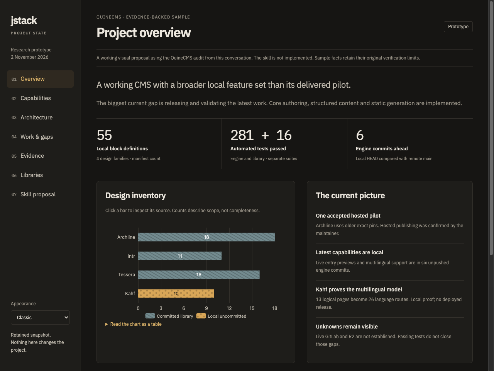
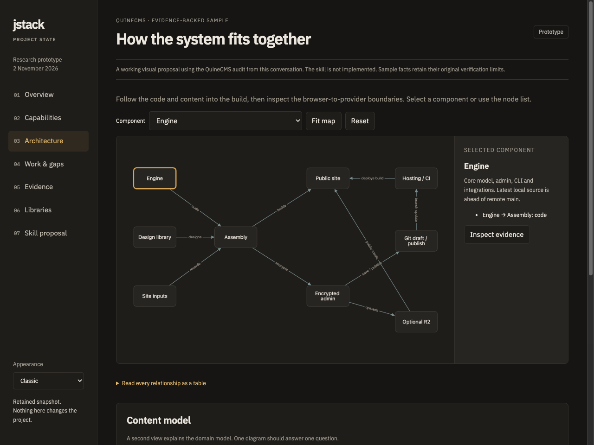

# Project-state visualizations and skill handoff

This is the starting point for continuing the project-state skill and rich visual report research. The user asked for a jstack skill that audits a project's status, full functionality and specifications, bugs, pending items, gaps and work in progress. They selected **research, a proposal and a working Fungi prototype** for the first pass, then requested that the findings be handed off in Fungi's wiki for another model.

The user is comfortable extending Fungi with selected libraries. No particular library, final skill name or implementation plan has been accepted. The proposed name is `project-state`. The research and prototype are complete; the reusable skill and visualization components remain unimplemented.

The original detailed proposal, including its audit workflow, snapshot fields and library comparison, is preserved as a [dated research snapshot](../evidence/2026-11-02-project-state-handoff/original-jstack-proposal.txt). The sections below adapt its findings to the current Fungi repository boundary.

## First read: tested app versus current engine

The distinction below governs continuation. The earlier statement that Fungi already renders the selected libraries applies to the **installed legacy app**, not the current source checkout.

| Surface | Identity | What is established |
| --- | --- | --- |
| Tested native host | Installed `v0.1.0-alpha.2`, protocol 1, macOS/WKWebView | Direct HTML launch, page API, ECharts SVG, Cytoscape Canvas, Pele SVG and draft saving worked in the prototype. |
| Current Fungi source | Revision `ee4c72b125fc5c2b33449bc3b866ae8e155c2569`, 0.2 development, protocol 2, package format 3 | Headless Go engine. All UI, assets and runtimes belong to external helpers in other projects. Direct HTML launch and the old page bridge have been removed. |
| jstack source used for the prototype | Base revision `73a44f88c494a72c1ef0e0b2c9b06953644d740d`, with pre-existing local UI changes | Current local `fungi-ui` assets were copied into a retained bundle. The manifest fingerprints those copied files; the base commit alone does not identify the tested UI. |

Read [current decisions](../planning.md#current-decisions), [helper authoring](../authoring.md) and the [session contract](../contract.md) before implementation. The accepted engine-only boundary has not been reversed. Keeping this research here does not assign a renderer, chart library or maintained UI companion to this repository.

The original proposal's `fungi-ui` additions remain suitable for a UI-owning project. For protocol 2, an external helper must host the report and connect its draft/result actions to the NDJSON helper protocol. That integration was **not implemented or tested**. The prior page API is not an engine-2 API, and the legacy smoke driver must not be treated as an engine-2 driver.

Repository ownership also needs a precise reading: Fungi's older notes direct skill work to `fungi-skills`; its current README identifies that repository as authoring examples and jstack as the maintained daily-use collection. The user requested the new skill under jstack. Keep implementation there unless later instructions change the destination; use `fungi-skills` as a reference, not an installation dependency.

## Intended audit behavior

The skill should inspect accessible evidence systematically and explain the project in depth:

- Resolve the project boundary, related repositories, branches, revisions, dirty files, dependency pins and available environments.
- Inventory user and operator capabilities, entry points, prerequisites, roles, commands, routes, workflows, schemas, settings, integrations, constraints and failure behavior. Expand large categories into subfeatures.
- Reconcile accepted specifications, documentation and observed implementation. Keep contradictions and missing evidence visible.
- Inspect changes, history, planning records and available issue/PR sources for current, blocked, pending and deferred work. A changed file or TODO alone does not establish active work or a defect.
- Run proportionate safe verification and record revision, date, environment, result and limitations. Distinguish fresh checks, historical checks, maintainer reports, mocked providers and unknown outcomes.
- Explain local, committed, remote, released and deployed state separately. Preserve unknown deployment identity.
- Summarize risks, dependencies, unresolved decisions and useful next work. Compare changes only when a real prior snapshot exists.

Implementation, verification and delivery need independent state fields. A feature may be implemented locally, pass automated tests, and have no deployed proof. Reproduced, reported and suspected defects must also stay separate from missing requirements, documentation drift and missing verification. “No reproduced defect” is not a zero-bug claim.

Do not invent health scores, completion percentages, owners, deadlines, severity or historical trends. Include a coverage ledger for inspected and unavailable sources. Comprehensive inventory is not exhaustive defect detection. Preserve the existing project's record structure and accepted requirements; optional product ideas are not automatically gaps.

The proposed output is a detailed narrative, a versioned structured snapshot and a retained visual report. The proposed snapshot schema is `project-state/v1`, with stable IDs for capabilities, findings, architecture entities and evidence. Reuse existing feature IDs. Link claims to sources, revisions, timestamps, environments and limitations; avoid maintaining unrelated sets of facts in the narrative and UI. The full field proposal is in the [original research snapshot](../evidence/2026-11-02-project-state-handoff/original-jstack-proposal.txt).

An audit can create its requested reports and evidence. It does not independently authorize product fixes, commits, deployment or external messages. The enclosing task's existing authorization still applies. Report interaction or closing without submission does not accept a plan.

## Recommended visualization stack

These are dated research recommendations, not new engine dependencies. Versions below were checked on 2026-11-02. Only Pele, ECharts and Cytoscape were exercised in the visual prototype.

| Candidate | Recommendation and rationale | Primary references |
| --- | --- | --- |
| **Pele** | Reuse the diagram renderer already in Fungi UI. The tested bundle is 1.6.0; upstream research saw 1.13.0. Check syntax against the version actually shipped. | [API](https://pele.run/api), [compatibility](https://pele.run/compatibility), [earlier Fungi research](pele.md) |
| **ECharts 6.1.0** | Initial chart component. Broad interactive chart vocabulary; SVG suits moderate report charts, with Canvas available when justified. Evaluate a prebuilt subset instead of always shipping the full file. Apache-2.0. | [Features](https://echarts.apache.org/en/feature.html), [renderers](https://echarts.apache.org/handbook/en/best-practices/canvas-vs-svg/), [modular imports](https://echarts.apache.org/handbook/en/basics/import/) |
| **Cytoscape.js 3.34.4** | Optional relationship/dependency graph component. Add an accessible component selector, inspector and relationship table alongside its visual canvas. MIT. | [Documentation](https://js.cytoscape.org/) |
| **Existing Fungi UI and semantic HTML** | Default controls and modest inventories. The prototype already implements search, sorting and filtering without another table framework. | Local `jstack/skills/fungi-ui/`; [component research](components.md) |
| **Tabulator 6.7.1** | First grid candidate if large inventories require virtualization, grouping or tree data. Theme and interaction verification remain necessary. MIT. | [Docs](https://www.tabulator.info/docs/), [accessibility](https://www.tabulator.info/docs/6.x/accessibility/) |
| **Observable Plot 0.6.17** | Alternative chart stack for concise exploratory SVG plots. Avoid shipping both Plot and ECharts without a specific unmet need. ISC. | [Getting started](https://observablehq.github.io/plot/getting-started), [interactions](https://observablehq.github.io/plot/features/interactions) |
| **TanStack Table 9.3.1** | Alternative when fully custom table behavior is worth owning more UI code. Check current vanilla integration requirements rather than reusing older-version recipes blindly. MIT. | [Vanilla guide](https://tanstack.com/table/latest/docs/framework/vanilla/quick-start) |
| **React Flow 12.12.0** | Defer until editable/custom-node diagrams justify React. MIT. | [Overview](https://reactflow.dev/learn), [accessibility](https://reactflow.dev/learn/advanced-use/accessibility) |
| **ELK.js 0.12.1** | Optional advanced layout engine for ports and compound graphs. It computes layout rather than supplying the renderer. Registry SPDX: EPL-2.0 OR GPL-3.0-or-later. | [Repository](https://github.com/kieler/elkjs) |
| **Web Awesome 3.14.0** | Consider individual missing controls, not a wholesale UI replacement. Core is MIT; the researched grid/chart family belongs to Pro. | [Docs](https://webawesome.com/docs/), [Core/Pro](https://webawesome.com/support/) |
| **Radix Primitives** | Revisit if React becomes a chosen dependency. Existing vanilla components already cover the prototype. | [Introduction](https://www.radix-ui.com/primitives/docs/overview/introduction) |
| **Chart.js** | Viable narrower chart alternative; accessible Canvas output needs author-supplied alternatives. | [Accessibility](https://www.chartjs.org/docs/latest/general/accessibility.html) |
| **Vega / Vega-Lite** | Revisit for a larger declarative analytics surface. Multiple runtime pieces and expression/CSP choices add integration scope. | [Embedding](https://vega.github.io/vega-lite/usage/embed.html), [interpreter](https://vega.github.io/vega/usage/interpreter/) |

Start with **Pele + ECharts + existing controls**, and make Cytoscape optional. Add a grid or another layout engine only after actual report needs justify it. Read the existing [component survey](components.md) for broader controls, editors and drawing tools; this handoff narrows the selection for a concrete audit report.

Measured prototype browser files:

| Library | Raw bytes | Gzip bytes |
| --- | ---: | ---: |
| ECharts 6.1.0 | 1,121,883 | 370,016 |
| Cytoscape 3.34.4 | 435,649 | 137,356 |

The [vendor manifest](../evidence/2026-11-02-project-state-handoff/vendor-manifest.json) records registry URLs, tarballs, integrity values and SHA-256 hashes. Downloads were integrity-checked; licenses were retained in the temporary bundle. These figures describe the files, not startup performance, total application size or a benchmark against alternatives.

## Prototype and design lessons

The prototype uses the QuineCMS audit from the originating conversation as fixed example data. It does not perform an audit itself, and those project facts were not reverified for this handoff.

| View | Implemented demonstration |
| --- | --- |
| Overview | Concrete inventory/test/revision counts, ECharts bar chart, delivery-state table |
| Capabilities | Fourteen capability groups, search/filter/sort and evidence detail dialogs |
| Architecture | Nine-node Cytoscape map with selection, pan/zoom, inspector, keyboard selector and edge table; separate Pele entity diagram |
| Work and gaps | Five categorized findings and actual dated events |
| Evidence | Fresh, historical, reported and unknown evidence with limitations |
| Libraries | Candidate comparison and official source links |
| Skill proposal | Audit workflow diagram, responsibilities and optional Notes/next-work feedback |





Choose views to answer questions in the data. Do not add Gantt dates, heatmap scores or trend lines without evidence. Keep a detailed text alternative and evidence drill-down beside graphics. Charts need data tables; relationship canvases need keyboard-readable components and edges. ARIA labels and decals are helpful, not complete accessibility verification. [ECharts accessibility](https://echarts.apache.org/handbook/en/best-practices/aria/)

Shared components should accept validated data and constrained configuration, not arbitrary executable formatter strings in JSON. Reuse theme tokens, focus handling, reduced motion, error/empty states and current Notes controls. Keep fonts, modules, workers and other runtime assets local. Filesystem opening is not required: inline evidence and copyable source paths are sufficient initially.

The current jstack assembler copies the whole shared assets directory. Adding large vendors there would enlarge every workflow, even a small interview. Optional capability assembly and lazy loading therefore belong in the production design. The prototype keeps its new vendors in workflow assets and loads both eagerly; that is a feasibility simplification, not the proposed packaging policy.

## Evidence and its limits

The [browser results](../evidence/2026-11-02-project-state-handoff/browser-result.json) and [native results](../evidence/2026-11-02-project-state-handoff/native-result.json) are preserved from the completed research run, not rerun during this documentation handoff.

- Chrome `156.0.8078.74` rendered the chart, graph and diagrams; search, sort, empty results, evidence dialogs and draft saving passed. All seven views fit a 420px viewport. Chart rendering survived classic, paper and paper-dark themes.
- Browser request interception observed no remote runtime asset requests. The driver used its own loopback server, isolated browser profile and Fungi page-API test double.
- Installed protocol-1 Fungi rendered the same three libraries and exercised a detail dialog, component selection, workflow diagram and actual draft acknowledgement. Its fixture used isolated session state with the caller callback removed.
- The real user report was opened and visually inspected. No answer was supplied for the user. The report's optional feedback schema is `project-state-prototype/v1`, not the proposed audit schema.
- Native Resource Timing returned no entries. Its empty result is not independent proof of network isolation; offline evidence comes from the bundle inspection and browser interception.
- Large datasets, rendering performance, full keyboard/screen-reader behavior, error fallbacks, dynamic snapshot validation, draft reopen/recovery, feedback images, other platforms and protocol-2 integration were outside this feasibility scope.

The [original bundle manifest](../evidence/2026-11-02-project-state-handoff/manifest.json) fingerprints all 51 assembled files and records the environment. The [narrow screenshot](../evidence/2026-11-02-project-state-handoff/proposal-narrow.png) and preserved [browser driver](../evidence/2026-11-02-project-state-handoff/browser-driver.txt) / [native driver](../evidence/2026-11-02-project-state-handoff/native-driver.txt) support inspection. Driver paths are historical and machine-specific; adapt them rather than treating them as installed product commands. [Metadata validation](../evidence/2026-11-02-project-state-handoff/validation.json) covered the existing sixteen jstack skills and plugin manifest, not a new skill.

## Where to resume

The [handoff manifest](../evidence/2026-11-02-project-state-handoff/handoff-manifest.json) records copy provenance and hashes. Authored prototype files are preserved here as readable attachments:

- [HTML template](../evidence/2026-11-02-project-state-handoff/report.html.txt)
- [Report logic](../evidence/2026-11-02-project-state-handoff/report.mjs.txt)
- [Styles](../evidence/2026-11-02-project-state-handoff/report.css.txt)
- [Example data and diagrams](../evidence/2026-11-02-project-state-handoff/data.mjs.txt)
- [Prototype input](../evidence/2026-11-02-project-state-handoff/input.json.txt)

These are historical source evidence, not a maintained renderer in this repository. Reconstructing a runnable bundle requires the matching Fungi UI assets and pinned vendor files, followed by validation. The attachment copies match the relevant hashes in the tested bundle.

The original full bundle remains at:

```text
/var/folders/00/h_k67s0j5dq0qvg6ylqysk2w0000gn/T/project-state-preview-KxIdqJ/report.html
```

Its source/drivers remain under the `prototypeSource` path in the manifest. These temporary paths can disappear during system cleanup; use the preserved files and hashes for continuity. The detailed research and verification records also remain in the sibling jstack wiki:

```text
/Users/rengwu/Desktop/Projects/jstack/docs/wiki/discussions/2026-11-02-project-state.md
/Users/rengwu/Desktop/Projects/jstack/docs/wiki/verification/runs/2026-11-02-project-state-prototype.md
```

Do not collect the originating conversation's human feedback session from another model. Use a fresh, isolated fixture session for further testing and preserve the exact receipt for any new user report.

## Suggested continuation

1. Confirm the target host contract before coding. For current engine-2 integration, identify or implement an external report host in the UI-owning project. Keep Fungi core responsibilities unchanged unless a concrete engine limitation is demonstrated.
2. Define the audit snapshot and coverage ledger, independent state fields, evidence references and accepted-vs-observed behavior. Reuse existing project records and jstack's feature/verification workflows.
3. Build a prepared report and assembler so routine skill use supplies data rather than authoring another dashboard. Start with existing controls, Pele and one ECharts adapter.
4. Add the optional graph pack and selective asset packaging. Validate realistic inventories before choosing Tabulator, ELK or another framework.
5. Verify the actual target host: readiness, acknowledged drafts/results, artifact restoration, error/retry, cancel/close, exact-caller completion and reopen. For protocol 2, use the public helper contract, keep reading acknowledgments, and do not assume the old page bridge exists.
6. Test keyboard access, themes, narrow layouts, malformed/empty data, renderer failure, offline assets and representative large reports. Add baseline comparison only with stable IDs and a real earlier snapshot.

Final name, default audit depth, storage for projects without records, and the external host implementation remain open. This handoff records findings and a proposed direction; it does not claim those choices are settled or start their implementation.
